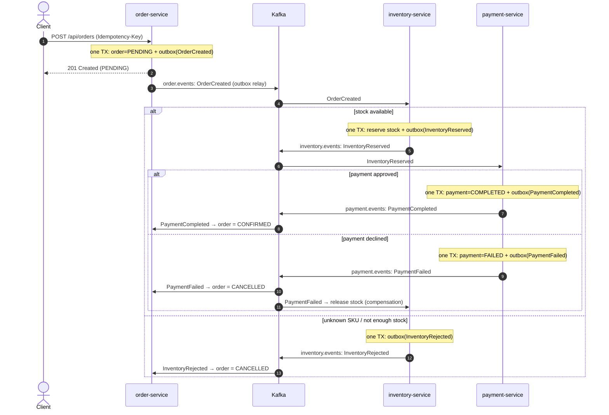

# Event-Driven Order Processing

A small learning project for Kafka and distributed system patterns. Three Spring Boot services create an order, reserve stock, and simulate a payment using events and separate database transactions.

The project explores:

- **Saga choreography:** services react to events, with compensation when payment fails.
- **Transactional outbox:** save business changes and outgoing events in the same database transaction.
- **Idempotency:** handle repeated HTTP requests and duplicate Kafka deliveries without repeating their effects.
- **Failure recovery:** retry failed messages, use dead-letter topics, and resume processing after a Kafka outage.

**Stack:** Java 21, Spring Boot, Apache Kafka, PostgreSQL, Docker

## Architecture



## How the patterns are implemented

Each service runs its own outbox relay against its own database.

### Transactional outbox

OutboxService stores an event in outbox_events inside the business transaction. OutboxRelay waits 500 ms between poll runs, sends unpublished events to Kafka, and sets published_at after acknowledgement.

Delivery is at-least-once: a crash after Kafka acknowledges a message but before the publication marker commits can cause a duplicate. Messages carry event-id and event-type headers so consumers can identify and decode them.

### Idempotency

- **HTTP:** IdempotencyKeyStore stores the request key, hash, and order ID. The same key and matching request return the existing order (200, Idempotent-Replay: true). A conflicting request returns 422; a missing key returns 400.
- **Kafka:** ProcessedMessageStore records (consumer, eventId) in the same transaction as the business changes. Repeated event IDs for that consumer are skipped.
- **Business state:** orders change only from PENDING, reservations are released once, and each order has at most one payment record.

### Compensation

When payment fails, the order service cancels the order and the inventory service releases the reservation, restoring stock. These are independent local transactions triggered by PaymentFailed.

InventoryService locks stock rows before checking availability and reserving units. It locks SKUs in a consistent order to reduce deadlock risk between concurrent reservations.

### Failure handling

Failed records are retried up to three times, one second apart, then sent to DLT. Malformed records skip retries. This is configured in SagaCommonAutoConfiguration.

## Run it

Requires Docker with Compose v2, Bash, and curl. Start Docker, then run from the repository root:

```bash
docker compose --profile apps up --build -d --wait
bash scripts/demo.sh
docker compose --profile apps down
```

The demo covers successful orders, duplicate requests, insufficient stock, and payment failure with stock restoration.
